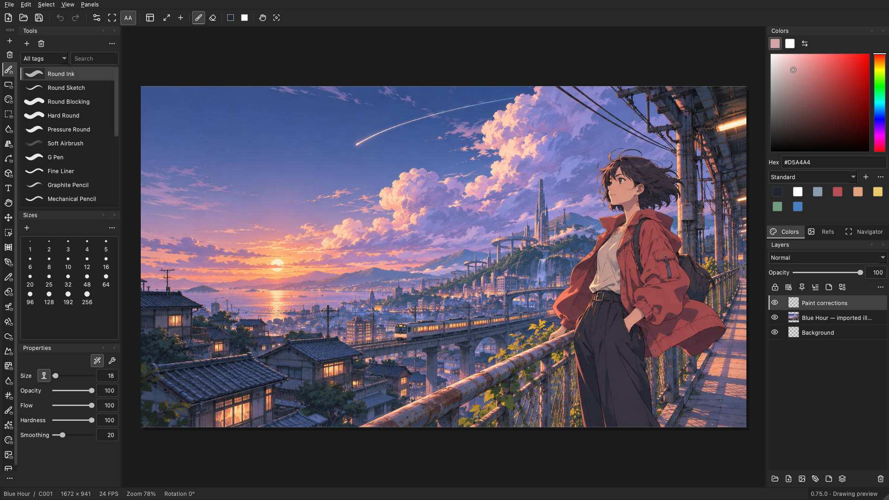

# Toon Pro

**Start with a drawing. Build toward hand-drawn anime.**

Toon Pro is a native desktop drawing and animation application being built for independent artists. Its purpose is to make the first canvas approachable, keep each drawing or animated shot focused, and put project organization around the work as it grows.

[Explore the website](https://complex1.github.io/ToonPro/) · [Read the artist guide](https://complex1.github.io/ToonPro/docs/) · [Downloads](https://complex1.github.io/ToonPro/download/) · [Vision](docs/product-vision.md) · [Product comparison](docs/product-comparison.md)



*An actual application capture with original illustration imported as artwork. [Screenshot and artwork provenance](https://complex1.github.io/ToonPro/credits/).*

## Why Toon Pro exists

An artist should be able to make a drawing before learning a production pipeline. Toon Pro follows that progression: begin with a canvas, explore movement in one shot, then organize the drawings, shots and references for a larger project.

The direction is an approachable path toward demanding hand-drawn anime work. A complete, studio-validated production pipeline is a longer-term goal. Today's source already contains substantial drawing and animation tools; the current work makes those capabilities easier to discover and use.

Toon Pro is for illustrators, artists learning frame-by-frame animation, and independent creators who want drawing, timing and project assets close together. [Read the purpose and design principles](docs/product-vision.md).

## Choose the right version

**The new project workflow is local development work. It is not included in the published 0.75.0 preview.**

| Experience | What to expect | Where to start |
| --- | --- | --- |
| Published **0.75.0** preview | Earlier project/startup flow with drawing, animation and sequence-review tools | [Downloads and platform status](https://complex1.github.io/ToonPro/download/) |
| Current **0.76.0** source / local build | Projects dashboard, Drawing / Animation / Movie projects, independent document tabs, folders and Assets | [First drawing](docs/getting-started.md) · [Implemented workflow and limits](docs/managed-workspace.md) |
| Product vision | Deeper production handoffs, sequence organization and validated delivery workflows | [Vision and boundaries](docs/product-vision.md) · [Development checklist](docs/TODO.md) |

The public preview registry currently lists an Apple Silicon Mac download. Intel Mac and Windows downloads remain in validation; their build targets do not imply an available verified package. Linux distribution is deferred. Check the [download page](https://complex1.github.io/ToonPro/download/) for the published package, requirements, checksums and installation notes. The site reflects its last deployment; [the local release registry](website/releases.json) and [development log](docs/DEVELOPMENT.md) record repository status.

## A simple way into the work

The current local build starts on **Projects**, with compact thumbnail cards. Create a project for what you want to make:

| Project | Your dashboard | Your editor |
| --- | --- | --- |
| **Drawing** | Drawings and a direct **New drawing** action | One drawing, with its own canvas and layers |
| **Animation** | A collection of independent shots and **New animation** | One animated shot, with its own FPS and duration |
| **Movie** | Nested folders containing drawings and single-shot animations | The same focused drawing or single-shot editor |

Create a drawing with a name, canvas size and background. Preview the canvas before creating it. Movie content can also receive predefined or custom tags.

Select several drawings or animations and **Open selected** to work in tabs. Each tab retains its own artwork, undo history, timing and canvas view. Projects navigation and document tabs share one header row to preserve vertical canvas space. [Follow the walkthrough](docs/getting-started.md).

## Tools that grow with your practice

- **Draw and paint:** raster and editable vector artwork, brush families and dynamics, layers, masks, selections, transforms and perspective guides.
- **Develop characters:** model sheets, reference images, named color models, variants and previewed recoloring.
- **Animate one shot:** drawing exposures, holds, onion skin, Light Table, layer/property animation, cameras, reusable Symbols and manual timed poses.
- **Work with sound and output:** shot-local audio and supported image/video/audio exports. Codec and platform support follow the actual build.
- **Keep materials organized:** project-owned image/video/audio imports, folders, tags, explicit media previews and reversible removal. **Move to Assets** retains a native drawing or animation's identity and editable source.

Rendered 3D reference tools are available in supported Apple Silicon Mac builds. They are a reference/posing capability, rather than a finished character-animation pipeline. Individual workflows and limits are described in the [artist documentation](https://complex1.github.io/ToonPro/docs/) and [source documentation](docs/DEVELOPMENT.md).

## What makes this direction useful

Toon Pro brings a drawing-first entry, independent shot documents and a separate project/asset dashboard into one native application. Project files live in ordinary folders on a drive you choose. The focused editor lets you develop one image or shot without organizing a whole film inside the canvas.

Those are specific workflow choices, not a claim to be faster or more capable than every established product. Clip Studio Paint, Krita, OpenToonz, Harmony and Blender each have strengths and different intended uses. [Compare the workflows and tradeoffs](docs/product-comparison.md).

The new manager does not yet provide a complete movie-editing timeline, a global asset library, live linked placement, collaborative production tracking or a finished delivery pipeline. Large-project memory, physical tablet feel, additional platform packaging and broader failure recovery still need acceptance work. [Current limits](docs/managed-workspace.md) · [Roadmap](docs/TODO.md).

## Build the current source

The application uses **C++20, Qt 6 Widgets and CMake**. Python supports development and packaging; it does not run the drawing editor.

Install a C++20 toolchain, CMake 3.24+, zlib and the pinned Qt **6.10.3** SDK with QtBase, QtSvg and QtMultimedia. The app requires Widgets, SVG, Concurrent, SQL/SQLite, Multimedia and MultimediaWidgets. Qt Test is needed for tests.

For a 2D development build, point CMake at your installed Qt SDK:

```sh
cmake -S . -B build \
  -DCMAKE_PREFIX_PATH="/path/to/Qt/6.10.3/platform" \
  -DTOON_ENABLE_FILAMENT=OFF -DBUILD_TESTING=ON
cmake --build build --config Release --parallel 4
ctest --test-dir build -C Release --output-on-failure --parallel 2
```

On macOS, open `build/ToonPro.app`. For Windows, use the executable produced by the selected CMake configuration. Install/package only after the corresponding platform checks pass.

For SDK installation, Apple Silicon 3D builds, Windows toolchains, packaging and matching dependency sources, see [the preserved build recipes](docs/feature-history.md#build-test-and-package-locally) and [packaging requirements](docs/packaging.md). GitHub Actions is currently disabled; builds and release work stay local/manual. Packaging a build does not publish it.

## Find your next step

| I want to… | Read |
| --- | --- |
| Make my first drawing in the current build | [Getting started](docs/getting-started.md) |
| Understand the purpose and direction | [Product vision](docs/product-vision.md) |
| Understand other products and Toon Pro's fit | [Evidence-based comparison](docs/product-comparison.md) |
| Organize projects and assets | [Managed workspace](docs/managed-workspace.md) · [Illustrated guide source](website/content/projects-and-assets.md) |
| Learn tools and animation | [Illustrated artist manual](https://complex1.github.io/ToonPro/docs/) |
| Inspect implementation and verification | [Development log](docs/DEVELOPMENT.md) · [Architecture](docs/architecture.md) |
| See plans and unresolved acceptance work | [Checklist](docs/TODO.md) |
| Find older feature descriptions and release records | [Feature history](docs/feature-history.md) |
| Build or maintain the website | [Website source guide](website/README.md) |

Pricing and application licensing have not been decided. Source availability and third-party dependency notices do not establish a free-use policy or an application license. Record the specific build, workflow and reproduction steps when reporting an issue through the [repository](https://github.com/complex1/ToonPro).
