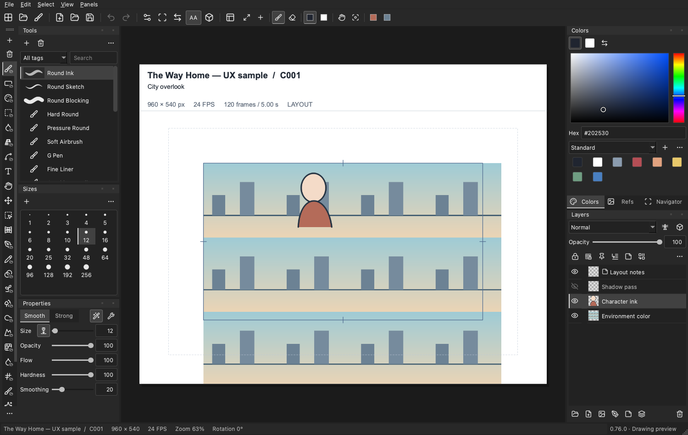

# Toon Pro

**A native drawing workspace for hand-drawn artwork, with animation and project organization when you need them.**

Toon Pro combines raster painting, editable vector strokes, character references and poseable 3D reference layers in a C++/Qt desktop application. Start with a drawing, keep several documents open, and organize source material in a local project. Animation documents add a shot-local timeline without turning every drawing into a movie project.

This repository is the **0.76.0 development source**. Published **0.75.0 preview packages** use the earlier workflow and do not contain every feature described here. Match the version and build evidence when comparing source, screenshots and downloads. Current work prioritizes the drawing workspace and UX; implemented animation tools remain available.

[Website source and local preview](website/README.md) · [Detailed manual and feature content](website/data/manual.json) · [Public website](https://complex1.github.io/ToonPro/) · [Source](https://github.com/complex1/ToonPro)

The rebuilt website is included in this checkout; the public site changes only after a separate deployment.



*Actual 0.76 application capture with a synthetic sample document. [Capture provenance](website/assets/screenshots/current/index.json).*

## What the product does

- **Draw first.** Create a named canvas with a size and background, then open a focused editor with tools, colors and layers.
- **Keep documents independent.** Each drawing or single-shot animation has its own artwork, canvas dimensions, undo history, view and timing. Tabs retain work while you browse the dashboard.
- **Organize around artwork.** Drawing, Animation and Movie projects provide galleries; Movie projects add folders and tags. Assets stores project-owned media and editable native items.
- **Keep source editable.** Vector strokes, supported layer effects, Puppet Warp state, character palettes and 3D references retain native data within their supported workflows.
- **Work locally.** Projects are ordinary `.toonstudio` folders on a drive you choose. The current workspace uses a local filesystem and one writer.

The editor is a native application. The website explains it; it does not run the C++ drawing engine in your browser.

## Basic requirements

| Requirement | Local source build |
| --- | --- |
| Language/toolchain | C++20 compiler; Apple Clang on macOS or Visual Studio 2022 C++ tools on Windows |
| Build system | CMake **3.24+**; a compatible build generator |
| Qt | CMake requires **Qt 6.10+**; reproducible recipes/package checks use **Qt 6.10.3** |
| Qt components | Core, Gui, Widgets, Svg, Concurrent, Sql/SQLite, Multimedia and MultimediaWidgets; **Qt Test** for tests |
| Native dependency | zlib development library matching the target architecture/toolchain |
| Development helpers | Git; Python **3.10+** for SDK/setup, packaging and helper tests |
| Optional runtime | Local RIFE executable/model for generated in-betweens; installed separately |
| Storage | Writable local folder with room for native revisions, imported media and backups |

macOS builds target **macOS 13+**. Windows packaging targets **Windows 10 1809+ / Windows 11 x64** with the MSVC 2022 SDK. Active distribution work covers Windows and macOS; Linux recipes remain in [packaging documentation](docs/packaging.md), with Linux distribution deferred.

There is no certified universal minimum RAM/GPU specification yet. Canvas size, layers, animation frames and retained tabs determine working memory. Physical pen-display feel and production-scale acceptance require separate testing.

## Build the current source

Run commands from the repository root. Use a separate build folder for each architecture or incompatible toolchain. Each step must succeed before continuing.

### 1. Get the source

```sh
git clone https://github.com/complex1/ToonPro.git
cd ToonPro
```

For an existing checkout, use its current source rather than cloning over it.

### 2. Install dependencies

Install CMake and your platform's compiler first. On macOS, `xcode-select --install` installs Apple's command-line developer tools if missing. Use your installed zlib development library; Windows needs a matching package as shown below.

Install QtBase, QtSvg and QtMultimedia through Qt's installer, or use this pinned SDK recipe. QtBase supplies the core/widgets/SQL/test components.

**macOS:**

```sh
python3 -m venv .venv
.venv/bin/python -m pip install aqtinstall==3.3.0
.venv/bin/python -m aqt install-qt mac desktop 6.10.3 clang_64 \
  --outputdir .deps/Qt --modules qtmultimedia \
  --archives qtbase qtsvg qtmultimedia
```

The SDK prefix is `.deps/Qt/6.10.3/macos`. An existing Qt installation works too; substitute its SDK prefix in the configure command.

**Windows:** use Developer PowerShell for Visual Studio 2022 with **Desktop development with C++** installed, and set `$vcpkgRoot` to your existing vcpkg checkout.

```powershell
python -m venv .venv
.venv/Scripts/python.exe -m pip install aqtinstall==3.3.0
.venv/Scripts/python.exe -m aqt install-qt windows desktop 6.10.3 win64_msvc2022_64 `
  --outputdir .deps/Qt --modules qtmultimedia `
  --archives qtbase qtsvg qtmultimedia

$vcpkgRoot = "C:/vcpkg"
New-Item -ItemType Directory -Force .deps/triplets | Out-Null
@'
set(VCPKG_TARGET_ARCHITECTURE x64)
set(VCPKG_CRT_LINKAGE dynamic)
set(VCPKG_LIBRARY_LINKAGE static)
'@ | Set-Content .deps/triplets/toon-x64-windows.cmake
& "$vcpkgRoot/vcpkg.exe" install zlib:toon-x64-windows `
  "--overlay-triplets=$PWD/.deps/triplets"
```

### 3. Configure and compile

**macOS:** this baseline omits the legacy optional Filament renderer. The current canvas 3D reference workspace uses its independent base-color preview and remains enabled.

```sh
cmake -S . -B build \
  -DCMAKE_PREFIX_PATH="$PWD/.deps/Qt/6.10.3/macos" \
  -DCMAKE_BUILD_TYPE=Release \
  -DTOON_ENABLE_FILAMENT=OFF \
  -DTOON_ENABLE_EXPERIMENTAL_3D=ON \
  -DBUILD_TESTING=ON
cmake --build build --config Release --parallel 4
```

**Windows:** keep the same PowerShell session and `$vcpkgRoot` from the dependency step.

```powershell
$qtRoot = "$PWD/.deps/Qt/6.10.3/msvc2022_64"
cmake -S . -B build -A x64 `
  "-DCMAKE_PREFIX_PATH=$qtRoot" `
  "-DCMAKE_TOOLCHAIN_FILE=$vcpkgRoot/scripts/buildsystems/vcpkg.cmake" `
  "-DVCPKG_OVERLAY_TRIPLETS=$PWD/.deps/triplets" `
  -DVCPKG_TARGET_TRIPLET=toon-x64-windows `
  -DTOON_ENABLE_FILAMENT=OFF `
  -DTOON_ENABLE_EXPERIMENTAL_3D=ON `
  -DBUILD_TESTING=ON
cmake --build build --config Release --parallel 4
```

| Build option | Behavior |
| --- | --- |
| `BUILD_TESTING=ON` | Builds the CTest/Qt Test suites; requires Qt Test |
| `TOON_ENABLE_EXPERIMENTAL_3D=ON` | Default compatibility-named switch enabling approved canvas 3D reference authoring; `OFF` omits its authoring UI |
| `TOON_ENABLE_FILAMENT=OFF` | Omits the legacy optional renderer; keeps the independent reference preview |
| `TOON_ENABLE_FILAMENT=ON` | Requires the pinned SDK on macOS arm64; configuration fails if unavailable |

See [3D reference workflow](docs/3d-reference-workspace.md) and [platform packaging](docs/packaging.md) for the separate renderer capabilities.

### 4. Run the application

On macOS:

```sh
open build/ToonPro.app
```

On Windows, make Qt's runtime discoverable for a development launch:

```powershell
$env:PATH = "$qtRoot/bin;$env:PATH"
& ./build/Release/ToonPro.exe
```

That Windows path is for the Visual Studio generator in the recipe. Other generators may put `ToonPro.exe` directly in the build directory. Development builds expect their SDK/runtime; follow [packaging](docs/packaging.md) for a relocatable distribution.

The executable also accepts an existing managed project folder as its positional argument, and supports `--help` and `--version`.

### 5. Run tests

```sh
ctest --test-dir build -C Release --output-on-failure --parallel 2
python3 -m unittest discover -s tests -p 'test_*.py'
```

On Windows, use `python` for the second command and retain the Qt runtime `PATH` from the launch step. CTest covers native engines, storage, brushes/selections/transforms, panels, animation, media and project workflows. Python tests cover supporting scripts. A source test run does not verify a newly packaged runtime on another OS.

For one family, use a regex filter, for example `ctest --test-dir build -C Release --output-on-failure -R 'fill_reference|perspective'`. [Current full verification and limits](docs/testing-2026-11-08.md) records this rebuild's results. [Release acceptance](docs/release-acceptance.md) and [packaged-runtime verification](docs/packaging.md) are separate checks.

## Make your first drawing

1. Open **Projects** and choose **New project → Drawing**.
2. Name the project, choose its location and **Create project**.
3. Choose **New drawing**, enter a name, select size/background and review the live canvas preview.
4. Choose **Create drawing**. Select a group in **Toolbox**, a brush in **Tools**, and a foreground color in **Colors**.
5. Draw on an editable layer. Use **Cmd/Ctrl+S** or **File → Save document** to save.

With canvas focus: **B** Brush, **E** Eraser, **I** Eyedropper, **H** Hand, **Space-drag** pan, wheel zoom, **Cmd/Ctrl+Z** Undo and **Shift+M** mirror view. Text fields retain ordinary editing behavior. A tab asterisk marks unsaved artwork; closing it offers Save / Discard / Cancel.

Use **Project dashboard** to return to the gallery. Select several documents with Cmd/Ctrl-click or Shift-click, then **Open selected**. Each tab retains its work. [The complete first-session guide](docs/getting-started.md) explains assets, animation projects, recovery and backups.

## Implemented features

These describe the current source. **Local 0.76** identifies additions outside the published 0.75 preview. Detailed guides specify supported inputs, constraints and failure behavior.

| Area | Implemented behavior | Detailed guide |
| --- | --- | --- |
| Projects/tabs — local 0.76 | Drawing / Animation / Movie projects, independent documents, retained tabs, galleries, supported folders/tags | [Managed workspace](docs/managed-workspace.md) |
| Assets — local 0.76 | Project-owned copies, image/media previews, native editable assets, reversible removal and organization Undo | [Assets](docs/managed-workspace.md#asset-management) |
| Save/recovery — local 0.76 | Versioned saves, recovery snapshots/prompts and saved-project backup copies | [Save/recovery/backup](docs/managed-workspace.md#save-recovery-and-backup) |
| Workspace | Dockable/floating panels, fixed Toolbox icon column, saved layouts, focused canvas and accessible icon help | [Workspaces](docs/workspaces.md) |
| Brushes | Raster/editable-vector strokes, sampled tips, connected brushes, patterns, dynamics and per-tool settings | [Brush settings](docs/brush-settings.md) |
| Tool library | Groups, search/tags, previews, independent duplication, management and organization history | [Drawing tools](docs/drawing-tools.md#finding-tools) |
| Brush imports | Supported ABR tip/descriptor imports with documented conversion boundaries | [Compatibility](docs/brush-compatibility.md) |
| Inking — local 0.76 | Smooth / Strong stabilization, view-scale-aware strength, dead zone/finish policy and mirrored view | [Stabilization](docs/stroke-stabilization.md) |
| Vector editing | Path/node/local-width editing, Simplify/Width brushes, intersection trimming and local Vector Nudge | [Drawing tools](docs/drawing-tools.md) |
| Layers | Raster/vector/text/Notes layers, groups, visibility, locks, opacity, blend modes, clipping and masks | [Layers](docs/layers.md) |
| Selections/transforms | Geometric/freehand/color selection, feathering, saved selections, canvas transforms and precise fields | [Selections](docs/selections.md) · [Tools](docs/drawing-tools.md) |
| Fill — local 0.76 additions | Expansion, Enclose filling and persistent reference boundaries while coloring a separate raster layer | [Fill references](docs/fill-reference.md) |
| Perspective/guides | Editable snapping assistants, perspective/curved guide families, local ellipse and reviewed image/layer detection | [Guides](docs/guides.md) · [Detection](docs/perspective-detection.md) |
| Puppet Warp — local 0.76 | Editable raster source/mesh/pins, density, fixed anchors, multi-pin moves, persistence and explicit baking | [Puppet Warp](docs/puppet-warp.md) |
| Effects | Supported live layer effects/previews; local Outline retains editable source | [Outline](docs/layer-outline.md) · [Layers](docs/layers.md) |
| Conversion — local 0.76 | Previewed raster lines, denoise, cel/grayscale/screentones, retained originals and Undo | [Line/tone conversion](docs/line-and-tone-conversion.md) |
| Character references | Embedded model sheets, named color roles, lighting palettes and previewed recoloring | [Color models](docs/drawing-tools.md#character-color-models) |
| Cel coloring/Light Table | Paint Check review/repairs, shading layers, movable retained snapshots and saved drafts | [Cel coloring](docs/cel-coloring.md) |
| 3D references — local 0.76 | Editable canvas layers, posing/camera, Body/Head/Hand/Anime/Pets studies, supported GLB/glTF/VRM imports and Draw above | [3D workflow](docs/3d-reference-workspace.md) · [Sources](docs/3d-model-library.md) |
| History/Auto Actions | Artwork Undo/Redo and History; supported recorded commands with documented boundaries | [History/actions](docs/history-and-actions.md) |
| Frame animation | Exposures/holds, onion skin, timeline editing, playback ranges and independent shot timing | [Animation](docs/animation.md) |
| Animated properties | Layer transforms/opacity, compatible vector morphs, motion paths, easing, pivots and cameras | [Animation](docs/animation.md) |
| Symbols/timed poses | Document-local reusable definitions, linked instances, instance timing and manual lip-sync poses | [Symbols](docs/symbols.md) |
| In-betweens — optional local 0.76 | Local RIFE setup, output mode/easing, playback preview and one-Undo insertion | [In-betweens](docs/inbetweens.md) |
| Audio/output | Shot-local sound, waveform/synchronized playback and supported image/sequence/video/audio exports | [Animation](docs/animation.md) · [Runtime limits](docs/packaging.md) |

## Why choose Toon Pro?

Toon Pro brings focused drawing controls, independent shot documents and a separate local project/asset organizer together. Begin with one canvas, retain other drawings in tabs, keep references near the work, and add timing when needed. These are concrete workflow choices you can inspect in this source.

Established tools remain strong alternatives. This comparison describes fit; it does not claim benchmarked speed, universal superiority or full feature parity. Official competitor sources checked **8 November 2026**.

| Tool | Documented strengths | Where to evaluate Toon Pro |
| --- | --- | --- |
| **Clip Studio Paint** | Drawing/vector tools, cel timing, light table, onion skin, audio and cameras. PRO/DEBUT supports 24 animation frames; longer work needs EX. [Features](https://www.clipstudio.net/en/animation/) · [Limit](https://support.clip-studio.com/en-us/faq/articles/20190136) | Separate project organization and independent single-shot documents. CSP brush, 3D and file-format parity are not established. |
| **Krita** | Raster animation, timeline, curves, onion skin and storyboards; sound sync/scrub/export. [Animation](https://docs.krita.org/en/user_manual/animation.html) · [Audio](https://docs.krita.org/en/reference_manual/audio_for_animation.html) | Project-owned assets and mixed native-document galleries alongside drawing. Large-project performance remains unmeasured. |
| **OpenToonz** | Raster/vector animation, Xsheet/timeline, scanning and node effects. [Functions](https://opentoonz.github.io/e/) | Begin with one drawing or shot, then add organization. Equivalent scanning/compositing pipeline coverage is not established. |
| **Harmony** | Traditional/cut-out workflows; advanced rigging/compositing vary by edition; Node view is Premium. [Editions](https://helpcentre.toonboom.com/hc/en-ca/articles/48469939119763-What-is-the-difference-between-the-Harmony-Editions) | Focused drawing entry for independent work. Production dependencies on Harmony rigs/nodes/databases need direct evaluation. |
| **Blender Grease Pencil** | Drawing and traditional/cut-out animation inside a 3D environment. [Manual](https://docs.blender.org/manual/en/latest/grease_pencil/introduction.html) | A canvas-centered workflow. Toon Pro's reference preview does not replace Blender's modeling/rendering/hybrid production toolset. |

[The full comparison](docs/product-comparison.md) explains trade-offs and sources. Toon Pro pricing and application licensing are undecided; source availability and dependency notices do not establish free-use or open-source terms.

## Current boundaries

- Movie projects organize independent documents. The focused workspace does not provide a completed multi-shot editing/delivery pipeline.
- Assets are project-owned copies. A global library, live linked placement, automatic usage tracking and collaborative production management are unimplemented.
- Open tabs remain loaded. Automatic inactive-tab unloading and a certified large-production RAM budget are unimplemented.
- Backups capture saved state; they do not silently save dirty tabs. Keep the complete `.toonstudio` folder together. Native document payloads retain a **300 MiB** container limit.
- 3D references use a bounded base-color preview. Full CSP parity, full VRoid body/hair authoring, advanced shading and physics remain open; legacy skeleton/weight authoring stays retired.
- In-betweens need a separately prepared local RIFE runtime. Conversion/preview/codec operations have documented input and runtime limits.
- Local Mac tests do not certify Windows packages, physical tablets, clean-machine installs or a production release. Signing/release status belongs to the specific package.

[Priorities](docs/TODO.md) · [Development evidence](docs/DEVELOPMENT.md) · [Architecture](docs/architecture.md) · [Release acceptance](docs/release-acceptance.md)

## Documentation and website development

The rebuilt [`website/`](website/README.md) contains the landing page, searchable detailed documentation and an interactive feature catalog. Application screenshots include capture provenance and describe the captured development build.

The site uses Python **3.10+** and a dependency-free static builder:

```sh
python3 website/build.py --output build/website/ToonPro --base /ToonPro/
python3 website/check_site.py --root build/website/ToonPro --base /ToonPro/
python3 -m http.server 8000 --directory build/website
```

Open [the local preview](http://localhost:8000/ToonPro/). [The website guide](website/README.md) covers browser checks and screenshots. Building locally does not publish a site or release.

[Native getting started](docs/getting-started.md), feature guides under [`docs/`](docs/) and [feature history](docs/feature-history.md) remain readable without the website.

For an [issue report](https://github.com/complex1/ToonPro/issues), include app version/source revision, OS, build options, reproduction steps and a small sample when possible. Keep project backups before testing development builds.
