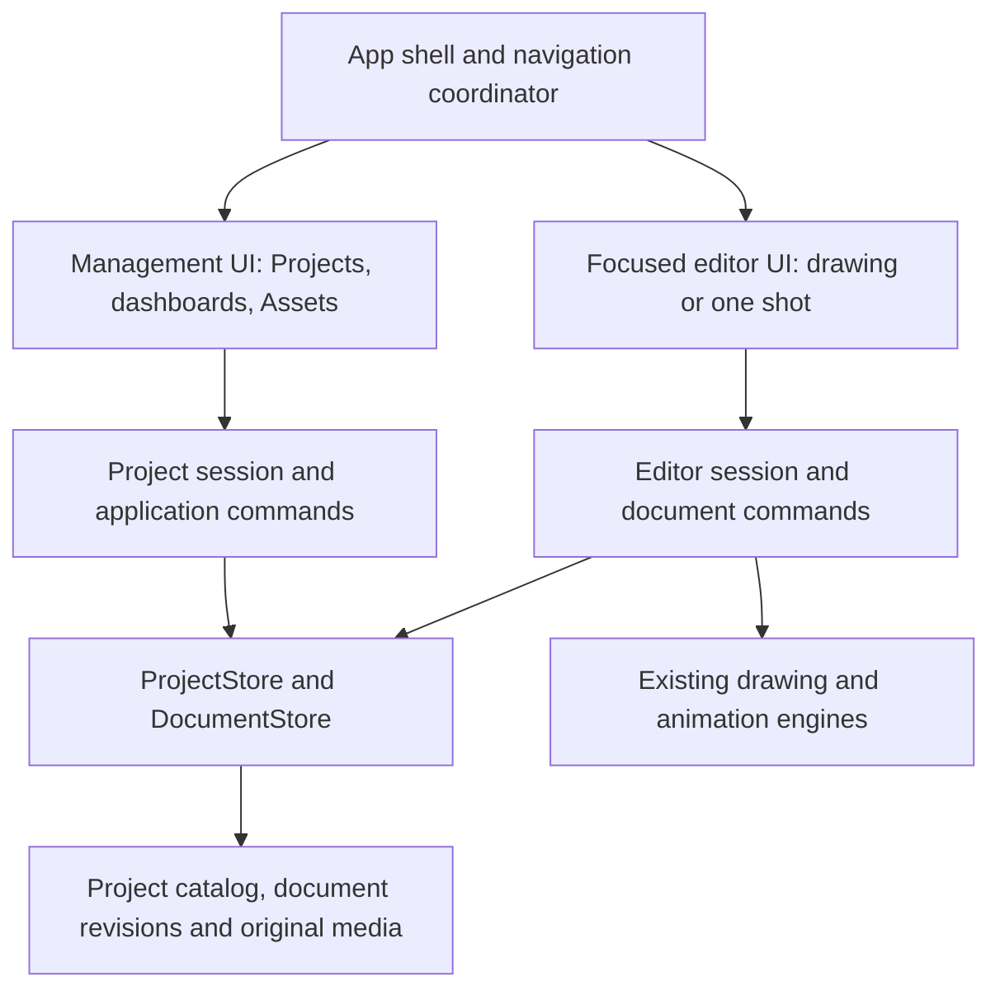

# Storage and application architecture

Development architecture · 5 November 2026 · Initial implementation available

**Current scope update:** the artist authorized development, requested multiple drawing/shot tabs, and excluded legacy migration because there is no existing artwork to carry forward. [Managed workspace](managed-workspace.md) describes implemented behavior and limitations. The proposal below remains the broader architecture direction; its legacy-conversion plan is excluded, and its one-resident-document starting point is superseded by retained document tabs. Recovery, backup and data-safety checks continue to protect new work.

This architecture direction follows the artist-defined [project flow](../design/ux-screens/project-flow.md), [asset management](../design/ux-screens/asset-management.md) and [screen designs](../design/ux-screens/README.md). Its initial working implementation is documented separately; future architectural refinements below are not all delivered. Repository findings below come from source inspection, not a new build or runtime benchmark.

## 1. Recommended decisions

| Question | Recommendation | Reason |
| --- | --- | --- |
| Separate disk/partition? | No. Use ordinary folders on a user-selected local drive | Simple setup, normal capacity usage, portable backups |
| Where do projects live? | A selectable Toon Pro workspace folder containing independent project folders; Open also accepts projects elsewhere | One useful default without trapping artwork in app settings |
| Is one giant library file authoritative? | No. Each project owns its catalog, native documents and imported media | Moving/backing up one project carries its required content |
| Where is project organization stored? | A small SQLite catalog inside each project | Transactions for folders, tags, item roles and revision pointers |
| Where are drawings/shots stored? | Independent native document files, initially reusing the existing checksummed container for one document at a time | Reuse engines; load/save only the selected drawing or shot |
| Where are imported originals stored? | Project-owned media files, outside the database | Stream video/audio and keep original bytes without rewriting the catalog |
| Management/editor codebases? | One repository, one installed Qt application/process, separate CMake modules | Shared identity, services, theme, shortcuts and immediate navigation |
| What does Move to Assets do? | Change collection/folder metadata for the same item ID | Keep source editability and existing references intact |
| What comes first? | Prove storage/session contracts with a small end-to-end slice before completing the dashboards | Avoid designing the new UI around the old all-shots container |

These are recommended technical choices, not claims of artist approval. No service, account, disk allocation, workspace relocation or application installation is created by this document.

## 2. What current source actually does

| Evidence | Present behavior | Consequence |
| --- | --- | --- |
| `src/studio_project.cpp/.h` | Version-1 `.toonstudio` directory has `project.toonstudio`, `project.toonproj`, `catalog.json`, `assets/` | Portable folder foundation already exists |
| `StudioProject::create` | Stages a complete directory next to its target and publishes by rename; preserves source on Save As | Reuse source-preserving publication/cancellation patterns |
| `StudioProject::importFiles/commit` | Copies original files under generated IDs; catalog uses a lock, hash conflict check and QSaveFile | Imported files are already project-owned copies; tags/folders are metadata |
| `src/project.h` | One Project owns every Shot, project-level Symbols/characters and shared width/height/FPS/transparency | The current native Project is not yet the new management-project model |
| `src/document.cpp` | One active Project and project-wide undo stack | Loading another Project clears history; a retained EditorSession is required |
| `src/storage.cpp` | Container signatures through 39; bounded manifests/resources; 300 MiB maximum container | A package does not remove artwork limits; splitting files does not remove per-document limits |
| `src/project_save.cpp` | Background snapshot encoding, same-filesystem staging and guarded publication | Useful save worker; not an atomic project-catalog-plus-payload transaction |
| `src/main_window.cpp` | Recovery timer at 30 seconds; recovery is beside the existing file; drafts/gestures are guarded | Existing recovery is periodic, not a stroke journal or backup |
| `src/project_home.cpp` | Local Recent/Pinned/Archived registry in workspace preferences | The Home list is not a complete authoritative inventory of all files on disk |
| `src/main_window_studio.cpp` | Home/production/canvas are stacked in the same window; management uses Canvas's active Document | Navigation foundation exists, but project management and authoring remain coupled |
| `CMakeLists.txt` | `toon_core`, `toon_workspace`, one executable; no Qt SQL dependency | Module extraction and SQLite packaging are development work |

Current catalog limits include 10,000 assets, 2,048 virtual folders and 16 MiB metadata. These are current bounds, not proposed unlimited capacity. Current types Film/Series/DrawingOnly also differ from the planned Drawing/Animation/Movie selection. Keep all of this honest in current-source documentation during migration.

## 3. User-visible storage model

Offer a default workspace such as **Documents/Toon Pro**, with Choose folder in settings/on first project creation. Resolve the actual Documents location through Qt, not a hard-coded operating-system path. Choosing a default should be a one-time preference; ordinary drawing creation must not ask for a filesystem location again. If the suggested location is cloud-synced, explain the local-folder requirement for active projects and allow another location.

Projects are normal directories, for example:

```text
<chosen workspace>/
  Sketchbook.toonstudio/
  Motion Practice.toonstudio/
  Moonlit Journey.toonstudio/
```

Open/import a project from another folder without silently moving it into the workspace. Register its location in Home. Changing the default workspace affects new projects; an explicit Move project operation handles existing ones. Moving between disks requires validated copy then publication; rename cannot be assumed to work across volumes. Do not remove the source until the destination is verified and the user deliberately requests a move rather than a copy.

Storage grows with saved documents, retained revisions and imported media. There is no reserved virtual disk, upfront capacity allocation or database server. Show project size, disposable cache size and available destination space separately. Stage saves/imports on the destination volume and account for temporary free-space needs; stream large media rather than buffering it all in RAM. Filesystem/file-size bounds still apply and must be validated.

Use three distinct locations:

| Location | Contents | Can normal cleanup delete it? |
| --- | --- | --- |
| User's project directory | Catalog, native documents/revisions, imported originals, durable recovery records | No; only explicit project/content lifecycle commands |
| Standard app config/data locations | Default workspace, known-project registry, preferences, layouts, tool libraries; emergency recovery under a distinct persistent data directory | Preferences/registry are recoverable; tool libraries and emergency recovery must not be treated as disposable |
| Standard app cache location | Regenerable thumbnails, waveforms, proxies and prepared previews, keyed by project/item/revision | Yes, within a bounded configurable budget; never original artwork or recovery |

Qt distinguishes these standard locations; use its platform API rather than manually constructing macOS/Windows paths. [Qt 6.10 QStandardPaths](https://doc.qt.io/qt-6.10/qstandardpaths.html).

Keep the workspace registry local and small. A first-level scan of registered workspace roots may discover project markers; do not recursively scan arbitrary disks or load artwork at startup. Projects opened elsewhere are remembered explicitly. Forgetting a Home entry never removes files. A missing external drive remains a readable unavailable entry with Locate/Open-at-new-location recovery.

## 4. Proposed version-2 project layout

The existing suffix `.toonstudio` can remain; the marker must explicitly declare version 2 so version-1 readers reject the new package. The following is an illustrative contract, not files to create in current user projects:

```text
Moonlit Journey.toonstudio/
  project.toonstudio                   # small format/version/project-ID marker
  project.sqlite                     # authoritative project organization
  documents/
    <item-id>/
      revisions/
        <revision-id>.toonproj        # immutable, complete drawing/one-shot snapshot
  media/
    <resource-id>/
      original.mp4                    # original bytes; safe generated path
  recovery/                          # durable session recovery records if needed
  .staging/                          # owned in-progress work; not published content
```

A project need not contain media until the artist imports some. Marker has package identity/schema information only; mutable title/type/order/tags belong to the catalog, avoiding two competing copies of metadata. Physical file paths use generated stable IDs, not user-entered titles. Store relative package paths and validate path containment. Display names and user-created folder hierarchy live in the catalog. Renaming Opening/Station does not move gigabytes of media or break paths. Preserve the existing refusal of unsafe project-owned symlinks/escaping paths until a separate safe-link design exists.

### Authoritative records

| Record | Required responsibility |
| --- | --- |
| Project | ID, Drawing/Animation/Movie type, title, schema version, defaults for new documents |
| Item | Stable ID, native/media kind, name, collection Content/Assets, folder ID, removed state, ordering, current saved/recovery revision pointers |
| Folder | ID, parent ID, name, collection; validate ancestry, no cycles and explicit root behavior |
| Tag / ItemTag | Predefined/custom label identity and many-to-many membership; consistent normalized matching |
| Document revision | Item ID, immutable file path, format, content hash, byte length and revision identity |
| Media resource | Resource ID, path, checksum, original name, length and detected media metadata |
| Usage/provenance | Explicitly recorded placement/source relation and pinned revision where relevant; distinguish copies from live dependencies |
| Operation log | Undo/recovery information for committed catalog operations and staged-publication reconciliation |

Per-document dimensions, background and animation FPS/duration belong to the native drawing/shot payload, not project-global fields. The catalog can cache revision-tagged summaries for dashboards; it cannot override the payload with stale dimensions. Project defaults seed new content. Changing defaults never changes existing drawings. White/transparent/custom background must render consistently; custom color needs an explicit native representation, such as a supported background layer, rather than silently mapping it to the existing transparency boolean.

Folder hierarchy and tags are independent. An Asset tag does not change collection membership. A native Drawing asset is still a Drawing, and an Animation asset is still one shot. Imported MP4 is Video, not editable Toon Pro animation; preserve that distinction in preview and commands.

### Why SQLite plus separate files

JSON remains suitable for a small versioned marker/export. The requested tree, filters, multiple tags, organizational undo and atomic Move to Assets are better served by a transactional catalog than rewriting one increasingly large JSON object for every change. Keep images/video/audio and native artwork outside the database. Do not introduce a remote database or a server process.

Recommend SQLite through Qt SQL/QSQLITE with schema migrations, foreign keys, indexes and short serialized writes on a storage worker. Qt lists QSQLITE as its SQLite driver. Add Qt SQL and verify the actual driver/library in both macOS and Windows packages; an installed developer SDK is not sufficient distribution evidence. [Qt SQL drivers](https://doc.qt.io/qt-6.10/sql-driver.html).

Start with one project writer, SQLite rollback journaling and `synchronous=EXTRA`, with foreign keys enabled and verified on every connection. Keep query pages and transactions short; do not hold a database transaction while copying/rendering media. Prefer this initial single-writer setup over adding WAL/concurrent writers before profiling. SQLite documents the rollback and sync guarantees and their filesystem assumptions. [SQLite atomic commit](https://www.sqlite.org/atomiccommit.html), [SQLite synchronous modes](https://www.sqlite.org/pragma.html#pragma_synchronous).

A connection belongs to its owning worker thread; views receive immutable result records or Qt models, never a database connection to use from arbitrary callbacks. A central ProjectStore contract permits changing implementation without teaching UI panels file paths or SQL. The spike must verify SQLite availability, packaging and durability behavior before the schema is adopted.

## 5. Documents, imports and organizational moves

### Independent native content

Initially each native item reuses `Project`/`.toonproj` through a DocumentStore adapter constrained to exactly one Shot. This reuses brushes, layers, cels, timing, camera, effects, sound and native validation. It is an internal bridge; the user does not choose Film for an animation.

Each item has its own Document instance, undo, dirty state and canvas/timing settings. Do not implement multiple independent drawings by adding more Shots to a shared in-memory Project. That would retain global canvas/FPS coupling and cross-document history.

Start with self-contained native payloads embedding the resources the engine currently supports. Imported original media is separately owned by the project. Place a copy can intentionally duplicate embedded pixels/audio; count both originals and embedded copies in storage usage. Shared blob stores/delta encoding can follow measured need, not precede the first correct save/reopen path.

### Import

Stream each file to an owned staging path while calculating length/hash. Validate the completed copy, publish under an immutable generated resource path, then commit all item/folder/tag/resource records for the batch in one database transaction. Before the database commit, prepared files are unreferenced; failure leaves no visible partial batch. A reconciler can later remove known abandoned staging/orphan files only after checking retained/recovery references.

Retain external originals. Duplicate filenames have independent identities. Hash matches can propose reuse; metadata equality alone must not overwrite an existing asset. Media decode/thumbnail failure does not imply original-byte storage failure. Do not promise video placement as a native animation layer: supported uses initially include preview, reference study or explicit conversion.

### Move to Assets

Use one catalog transaction: retain item ID and native revision/media-resource path; update collection/folder and requested tags; record a reversible organizational operation. No byte copy, flatten, render or ID change is needed. The same document can remain open while its breadcrumb updates. Existing placements still resolve to the original ID/revision. Move back performs the inverse operation.

Save a copy is separate and creates a new item identity, initially sharing only immutable resources when supported. Permanent deletion must consider retained revisions, recovery and recorded dependencies. Ordinary Remove is a reversible catalog state, not deleting bytes or just hiding an untracked live link.

## 6. Save, recovery and backups

A filesystem rename and a SQLite transaction are not one transaction. Design their publication order explicitly:

1. Capture a committed editor snapshot with project/item/session-generation and document-revision identity; never save a half-finished stroke/transform.
2. On a worker, encode a complete native revision in same-filesystem staging. Validate checksums/limits and flush through the platform durability implementation.
3. Publish the immutable revision file; synchronize the relevant file/directory metadata before committing its catalog pointer, as required by the target filesystem/OS.
4. Commit the new revision record and saved/recovery pointer in a short SQLite transaction, checking the expected prior item revision/session generation. A stale job cannot replace newer state.
5. Only after both succeed, emit Save completed. Mark the document clean only if that exact in-memory revision was saved; newer strokes remain dirty. Update summary metadata and invalidate its thumbnail by revision.

QSaveFile already supplies temporary-file-and-commit behavior for a complete file, including write-failure handling; keep direct-write fallback disabled. It does not make the independent catalog/payload publication a joint transaction. Power-loss durability needs explicit flush ordering and platform/filesystem tests; do not equate an atomic rename with a universal guarantee. [Qt QSaveFile](https://doc.qt.io/qt-6.10/qsavefile.html).

| Failure point | Required outcome |
| --- | --- |
| Before revision publication | Last saved revision stays authoritative; remove owned incomplete staging when safe |
| After file publication, before catalog commit | Previous pointer stays authoritative; retain/reconcile unreferenced prepared revision |
| Catalog commit fails / disk disappears | No false clean/saved indicator; retain dirty session and retry/recover path |
| App dies after catalog commit | Catalog points to a validated published revision; rebuild previews on reopen |
| Worker finishes after navigation/cancellation | Do not adopt it into a different session or replace a newer pointer |

Autosave initially follows the existing periodic/idle approach, with a separate recovery pointer from explicit Save. A successful autosave must not silently become an explicit saved state. Offer newer recoverable edits on reopening, preserve Save/Discard/Cancel when switching to another document, and never prune the only valid recovery. Recovery has a bounded, visible retention policy; avoid writing a full permanent revision for every pen sample. Full-document snapshots are a starting point, not an efficient unlimited history format.

Default retention proposal: current explicit save, one previous explicit save and latest recoverable snapshot per document, plus snapshots pinned by an active backup/export, undoable operation or future reviewed delivery. Prune only unpinned older files after successful publication and a grace period. Measure real disk churn; add version-history controls/incremental storage later. Do not call these ordinary save snapshots approved production revisions.

If the project disk becomes unavailable, retain the dirty session and offer an emergency self-contained recovery in persistent application-data storage, or Save a copy to a chosen local destination. Emergency recovery is not disposable cache and must be recorded for next launch. Show the failed primary destination clearly; never report the project as saved because only an emergency copy succeeded.

Backups are distinct from caches and recovery. Initially offer a consistent closed-project copy or coordinated backup that pins the catalog snapshot's referenced immutable files and copies them with a manifest of hashes. For a live catalog snapshot use SQLite's supported backup mechanism, then copy exactly its referenced resources; prevent garbage collection of that set until finished. Publish the backup only after validation. A raw copy of a changing database alone is insufficient. [SQLite backup API](https://www.sqlite.org/backup.html).

Uninstall/reinstall must not remove user-chosen project folders. Copy/move the whole closed project directory, then reopen its marker. Validate relocation without relying on the old workspace registry or absolute paths. A fresh-machine backup/restore acceptance test must include native content, originals, tags and folder hierarchy.

## 7. One codebase, two independent UI areas

Keep C++20, Qt Widgets, CMake and existing engines. Use proposed logical modules/targets, introduced incrementally:



| Proposed module | Owns | Must not own |
| --- | --- | --- |
| `toon_domain` | Project/item/folder/tag IDs, content kinds, commands and result contracts | QWidget, paths chosen by individual panels |
| `toon_storage` | Catalog/schema, native adapter, imports, revisions, lock, recovery, backup | Canvas tools or navigation widgets |
| `toon_management` | Home, typed dashboards, folders, Assets views | Active artwork undo or pixel edits |
| `toon_editor` | EditorSession, canvas, tool/layer controls, one-shot timeline and exports | Project collections, movie/scene review or directory mutation |
| `toon_app` | Route state, transitions, project/session lifetime, shared command routing | Brush/render algorithms |
| Existing/shared engines and UI | Raster/vector/cel/render/audio engines; theme/icons/controls | Duplicate management models |

These are target boundaries, not a request to rewrite all source files into new targets in one commit. Reuse `toon_core` behind adapters and extract from `toon_workspace` as dependencies become clear. Management and Editor both depend on domain/services; they do not depend on each other's widget classes. A separate editor executable/repository would require IPC, duplicate lifecycle handling and versioned communication before it provides value; defer it unless future crash isolation or independent distribution justifies the cost.

### Seamless navigation contract

AppCoordinator owns a route such as project ID + collection/folder + item ID + mode. A DocumentSessionManager owns EditorSession independently of whether its widgets are visible. The artist requested multi-selection opening multiple drawings/shots as retained editor tabs. Each tab owns its independent session/history/view state. An inactive-tab memory budget/eviction policy is a later refinement; do not promise unlimited open 4K documents.

| Artist action | Intended experience and data behavior |
| --- | --- |
| Launch | Show project cards from metadata/cached thumbnails; no artwork documents decoded |
| Open project | Show its typed dashboard by catalog query; do not load all drawings/shots |
| New drawing/animation | Validate setup, publish one item + initial native revision, then open its session; keep failed draft for retry |
| Open item | Reuse its already-open session or load only its native revision in background; show its name/loading state |
| Back to project / Assets | Keep the active session, selection, undo, canvas view and pending dirty state; restore dashboard folder/filter/scroll |
| Return to the same item | Resume retained session immediately; no intermediate export/import |
| Switch tabs / close or switch project | Switching tabs retains their dirty sessions after resolving active gestures. Closing a dirty tab or switching projects uses Save/Discard/Cancel; never discard on timeout |
| Save | Commit through shared storage services; dashboard receives item/revision updates and refreshes only affected thumbnail |
| Move open item to Assets | Update its organization/breadcrumb through shared item identity, preserving current editor session/history |
| Rename/tag/folder edit | Metadata command; never insert it into brush-stroke history |
| Export | Explicit immutable source revision or current committed snapshot; single-shot scope enforced in Editor |

Use Qt signals/slots or typed application events such as ItemCreated, ItemMetadataChanged and DocumentRevisionSaved. Pass stable IDs, never tree row numbers or a hidden Canvas pointer as the project handle. Cancel obsolete jobs and reject results with stale session/item/revision keys. Batch thumbnails and metadata queries; no SQL, media decoding or catalog traversal in pen-sample handlers.

Layouts are area-specific. Restoring an old custom layout cannot resurrect Shots/Scene/Movie controls in Editor; command routing must reject management operations there even if triggered by a shortcut/API. Only native drawing/one-shot capabilities are exposed. Shared theme, shortcuts and tools preserve continuity between Draw and Animate without sharing their production navigation.

Artwork undo belongs to the active document; organization undo belongs to the management project. Route Undo to the active area and provide a clear result label. A save/relocation is a storage lifecycle operation, not a brush stroke. Do not share one project-wide QUndoStack between unrelated documents.

## 8. Concurrent access and portability

Use a project-level writer lock and compare expected catalog/document revisions. A second application opening the same project offers read-only viewing or Open a copy. Do not steal a lock just because an operation took longer than a timer. Opening two independent copies with the same project ID requires an explicit clone/registration rule; key cache/session identity by location/incarnation as well as project ID until cloning creates a new ID.

First writable-storage target is a normal local filesystem on macOS/Windows, including a validated locally attached drive. Active databases on NAS/network shares or concurrently cloud-synced folders are not a supported collaboration solution. Offer a local working copy and closed-project backup/sync workflow; test particular filesystems before expanding support. SQLite explicitly documents locking and hot-journal hazards. [SQLite corruption/locking considerations](https://www.sqlite.org/howtocorrupt.html).

Legacy migration is excluded by the artist's instruction: there are no existing drawings to convert. Do not build Convert a copy, map old collections or silently rewrite version-1 projects as part of this work. The normal new application entry opens version-2 managed folders; retained version-1/editor code and tests remain engine infrastructure, not a conversion workflow.

## 9. Development order

The newer project-dashboard and asset requirements change the original UI-first Phase 1 ordering. The following storage/session sequence now precedes broader production tooling; retain the original single-shot boundary.

| Increment | Deliverable | Acceptance gate |
| --- | --- | --- |
| A · Storage/session spike | Version-2 marker, SQLite package dependency, one project catalog, one drawing/shot adapter, one revision save and catalog transaction | Create/reopen with independent dimensions; disk-full/cancel/stale-worker tests; packaged QSQLITE on Mac/Windows; original legacy file untouched |
| B · Working navigation slice | Projects → New project type → typed dashboard → New drawing → focused editor → Back; shared session/services | Two drawings of different sizes; save/reopen; undo/view/dirty-state retained when returning to same item; no timeline at startup |
| C · Single-shot animation | Animation dashboard, simple setup, assigned initial drawing, holds/playback and scoped exports | Multiple independent shot documents/FPS; two-drawing animation exports only its shot; simple/advanced data survives layouts |
| D · Folders and tags | Movie hierarchy, content organization, predefined/custom tags, transactional Move to Assets | Rename/move/undo preserves IDs/content and open session; no cycles/partial changes; Artist tag does not masquerade as asset membership |
| E · External asset management | Batch image/video/audio import, folders/search/filter, tags, thumbnails and explicit media preview | Original bytes preserved; cancellation/unsupported preview/duplicate-name paths work; bounded background work; copied placement never claims a live link |


Recovery, safe publication, backup and filesystem failure checks are foundations within A–E. Legacy migration is excluded; there is no separate sixth migration milestone. Each increment must include the applicable failure cases before it is marked done. Separate future work: global libraries, full revision-review production workflow, linked asset updates, giant-document storage, simultaneous collaborative editing and any full movie editor.

No date estimates until the spike resolves migration complexity and package dependencies. A successful screenshot is not an acceptance gate for storage or drawing feel. Subsequent implementation changes update README/workflow status and the development log with actual results, including physical Huion/native-focus acceptance separately.

## 10. Concrete next development task

Build increment A as an isolated, tested service/adapter path with a small internal fixture. Prove a Drawing project containing two differently sized drawings, save one without touching the other, move one into Assets without moving its bytes, and reopen after simulated failures. Include an independent single-shot fixture to prove the same adapter supports animation timing. Once this passes, connect the already-designed screens through increment B.

The initial implementation now exists in local source/builds; see [implemented controls and verification](managed-workspace.md). The module-extraction, memory-budget, richer asset and durability refinements remaining in this architecture document must not be advertised as delivered.
