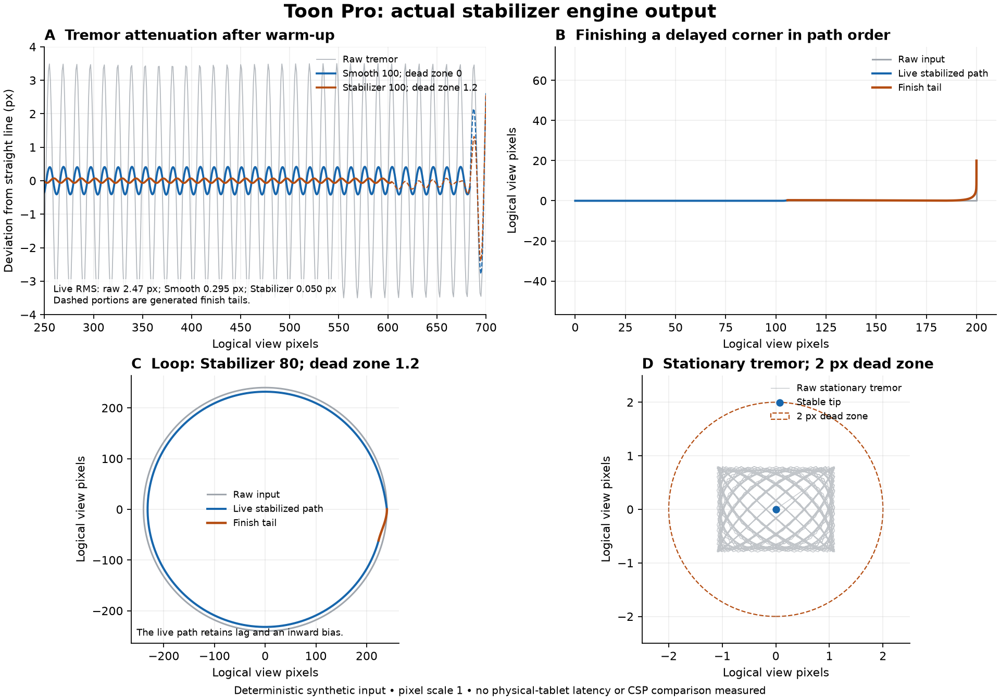

# Stroke stabilization: research, implementation and use

Local 0.76 development · 8 November 2026

The artist reported visible shakiness with stabilization at its maximum. This review combines the existing code audit, official application documentation and filtering research. Toon Pro now offers zoom-consistent **Smooth** and stronger **Stabilizer** modes. The implementation is original; the public Clip Studio Paint manual describes controls and behavior, not enough detail to reproduce its internal algorithm or establish identical pen feel.

## What was limiting the previous behavior

The original `StrokeFilter` was a causal first-order low-pass filter integrated over traveled artwork distance. Its maximum smoothing length was **24 artwork pixels**, with one-artwork-pixel resampling. At 25% view zoom that represents about six logical screen pixels; at 200% it represents 48. This made the same setting feel different at different working zooms. It also joined the trailing tip directly to the raw endpoint when finishing, potentially introducing an unwanted final segment.

These are source-level findings, not measurements of the artist's physical tablet or proof that every observed wobble had the same cause. Tablet sampling, brush texture, pressure response and display sampling can also affect the perceived result.

## What Clip Studio Paint documents

Its Correction category exposes stabilization strength, optional speed-dependent adjustment, and a separate post-correction stage. Higher stabilization trades fidelity to individual input movements for smoother lines. Post correction can reduce vector control points and offers speed/scale-related options. These describe distinct controls; they do not identify a published filter equation. [CELSYS Correction manual](https://help.clip-studio.com/en-us/manual_en/810_subtools/C.htm)

Krita's manual separately documents weighted smoothing and a stronger stabilizer, plus a dead zone, line finishing, sensor smoothing and zoom-related distance behavior. These are useful references for artist-visible choices and their tradeoffs. [Krita Freehand Brush manual](https://docs.krita.org/en/reference_manual/tools/freehand_brush.html)

## Algorithm options and their drawing tradeoffs

The suitability assessments below are engineering judgments for Toon Pro, not vendor benchmarks or a universal ranking of drawing applications.

| Method | What it does | Useful for | Tradeoff / decision |
| --- | --- | --- | --- |
| Distance-domain exponential smoothing | A low-pass filter follows the path; fixed-distance integration avoids depending on the number of pen events. | Everyday sketching and curves with moderate lag. | Rounds rapid changes and can retain low-frequency hand wobble. **Implemented as Smooth**, now measured in logical view pixels. |
| Finite weighted averaging | A local window averages neighboring input samples with weighted influence. | Reducing high-frequency tremor and reconstructing a delayed stroke tail. | A larger window rounds corners; a naive event-count window changes with tablet sample rate. **Used in the completion tail**, with path-distance weighting. |
| Pulled-string stabilization with dead zone | The painted tip trails the accepted input by a bounded leash; small motions can be ignored. | Controlled inking and long deliberate contours. | Greater strength introduces more lag and can suppress tight loops while contact is held. **Implemented as Stabilizer**, with explicit finishing behavior. |
| Speed-adaptive 1€ filter | Adjusts a low-pass cutoff using estimated motion speed. | A potential balance of steady slow input and responsive fast movement. | Needs timestamp calibration and tests for intentional small curves, pauses and replay. **Researched; not implemented in this pass.** The authors explain the jitter/lag tuning relationship. [Original project and tuning](https://gery.casiez.net/1euro/) |
| Mass/friction dynamics | A virtual brush follows the pointer through a physical motion model. | Expressive calligraphic flow. | Inertia can alter corners, reversals and endpoints; parameters need careful tuning. **Not selected for precision anime cleanup.** The original DynaDraw description models mass, velocity, friction and a rubber-band pull. [Paul Haeberli, DynaDraw](https://www.graficaobscura.com/dyna/) |
| Predictive/model-based filtering, such as Kalman filtering | Estimates motion and noise using a chosen state model. | Tracking tasks with an appropriate motion model. | More model/tuning complexity is not evidence of better freehand contours. **Deferred.** The 1€ paper compares filtering approaches, including Kalman filtering, in an interactive pointing evaluation; that evaluation is not an anime drawing benchmark. [Casiez, Roussel and Vogel, CHI 2012](https://gery.casiez.net/publications/CHI2012-casiez.pdf) |
| Post-stroke curve fitting | Revises the complete path after release, potentially using fewer control points. | Deliberate vector cleanup with a preview and reversible commit. | Can move approved corners or alter pressure/texture relationships; raster use needs retained source or stroke replay. **Deferred as a separate feature.** Existing vector simplification remains available. |

For this drawing workflow, the selected combination is a predictable general smoother plus an optional stronger stabilizer. The controls let the artist choose the lag/detail tradeoff. Automatic speed adjustment, general post correction, new sensor filters and CSP feature parity are not claimed.

## Implemented controls

The brush Properties header has two direct mode tabs: **Smooth** and **Strong** (Stabilizer). The normal **Smoothing** slider and exact entry still set strength from **0 to 100**. Tooltips and accessible names identify the modes. Open **Advanced brush settings → General** for the full mode names and additional tuning:

- **Smooth:** distance-based low-pass smoothing. At strength 100, the smoothing length is 24 logical view pixels. It keeps the more responsive existing drawing direction, with consistent scale across zoom levels.
- **Stabilizer:** a stronger pulled-string filter. Its maximum leash is `96 × (strength / 100)²` logical view pixels. Lower settings are intentionally much less heavy than the maximum. Large values introduce substantial trailing distance.
- **Dead zone:** 0–20 logical view pixels, active in Stabilizer mode. This suppresses small sensor/hand motions instead of allowing them to accumulate movement of the stable tip. Zero disables it.
- **Finish stroke:** enabled by default. Release traverses retained, locally smoothed path history in order, rather than drawing a single long line from the trailing tip to the raw endpoint. Turning it off ends at the last stabilized tip. It does not schedule a timer-driven tail after release.

Strength zero or disabling the existing **Smoothing** brush option keeps direct input. Mode, dead zone and finishing preferences are saved per tool in the tool catalog; switching tools restores their own values. These are editor-input settings, separate from the recorded brush resources used to replay an already-drawn vector stroke. Native brush-resource presets continue to carry their existing brush settings and strength; tool definitions carry the additional input-filter options.

## How it joins the drawing pipeline

At contact, Canvas snapshots the mode, strength, dead zone, finish policy and current artwork-to-view scale, including camera zoom. With guide assistance enabled, incoming positions are snapped before filtering and the output is constrained again before painting. Mouse/pen input is resampled by logical view distance; the selected filter produces a stable path and pressure for the raster/vector brush engine. Rotated and mirrored views use the same inverse coordinate mapping as ordinary drawing.

Settings changed during a stroke apply to the next stroke. Undo remains one drawing gesture. Escape and invalid input retain the existing cancellation rules. Modifier-constrained straight strokes and stamp placement keep their dedicated behavior. Guide snapping remains a geometric constraint; stabilization does not replace an ellipse or perspective ruler.

The filter retains at most 4,096 history samples and permits at most 65,536 generated samples per event. Completion is limited to 512 logical view pixels of pending history, with bounded interpolation work. Pathologically long repeated loops inside a large stabilizer leash can exceed that completion budget. The current stroke is cancelled with an explanation instead of publishing a partial or shortcut tail. Use Smooth or reduce strength for tight, repeated loops. This is a bounded first implementation, not an unlimited stroke recorder.

## Starting settings to evaluate with the tablet

These are proposed starting points, not measured optima for every hand or driver:

| Task | Try first | What to watch |
| --- | --- | --- |
| Rough sketching and small expressive curves | Smooth, strength 20–50 | Preserve gesture and small curls; raise strength only when wobble is distracting. |
| Clean, deliberate contours | Stabilizer, strength 50–70, dead zone 1–2, Finish on | Compare steadiness against trailing distance and corner rounding. |
| Very shaky long lines | Increase Stabilizer strength gradually | At 100 the leash is intentionally large; use a guide for an exact straight line or ellipse. |
| Tight repeated loops or small lettering | Smooth or a lower Stabilizer strength | Avoid a leash larger than the gesture itself. |
| Intentional taper ending before the pointer | Finish off | The final artwork ends at the stabilized tip. |

Physical acceptance should compare slow diagonals, pauses, circles, S-curves, corners, pressure ramps, pen lifts and eraser strokes at several working zooms. Software fixtures can measure input attenuation and confirm coordinate/Undo behavior; they cannot certify physical pen-to-screen latency or a match to CSP's feel.

## Verification and evidence



These deterministic fixtures come from the actual C++ filter, not a replacement simulation. On the horizontal trace after its first 250 view pixels, live vertical RMS falls from **2.469 px** raw to **0.295 px** with Smooth 100 / dead zone 0, and **0.050 px** with Stabilizer 100 / dead zone 1.2. These configurations use different lag and dead-zone settings. The measurement excludes the generated finish tails; those tails visibly return toward the raw endpoint. It is a fixture-specific attenuation result, not a physical-device latency measurement or a comparison with CSP. The loop also exposes the stabilizer's inward bias and trailing tip.

Reproduce the chart from the built test executable, with development-only `matplotlib` installed:

```sh
TOON_STABILIZER_REVIEW="$PWD/build/stabilizer-review" build/toon_stabilizer_tests optionalEngineReviewFixtures -platform offscreen
python3 scripts/plot_stabilizer_review.py build/stabilizer-review/stabilizer-engine-fixtures.json --output build/stabilizer-review
```

The plotter only reads exported engine samples. It produces PNG/SVG traces and a JSON metric summary; it adds no application runtime dependency.

Current build results, actual-engine fixture plots and the remaining physical-device acceptance are recorded in [DEVELOPMENT](DEVELOPMENT.md). Implementation: `src/stroke_filter.*`, `src/canvas.*`, brush properties, per-tool settings and focused stabilizer/UI tests. Earlier scalar-only filter tests retain their compatibility entry point; Canvas uses the new settings path.
